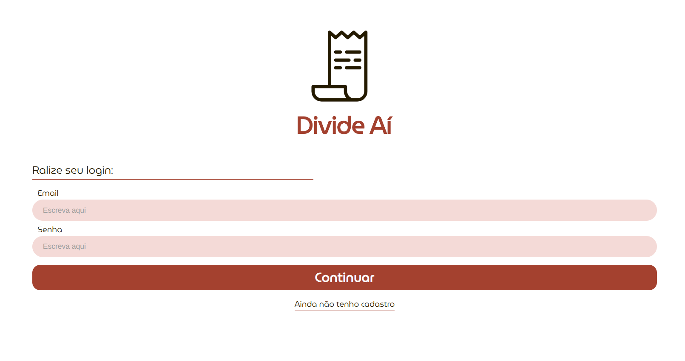
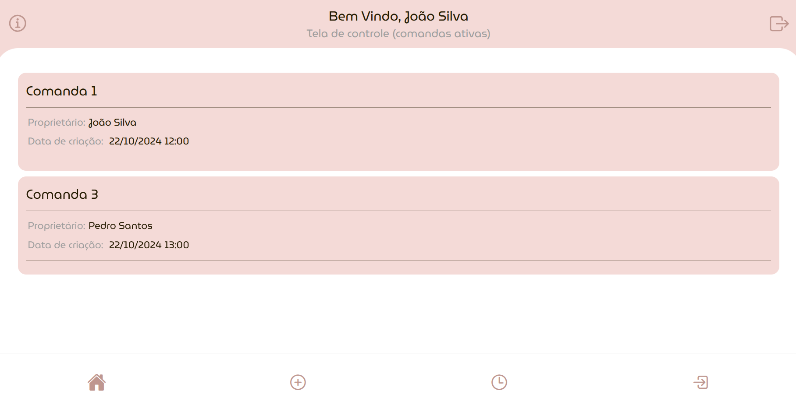
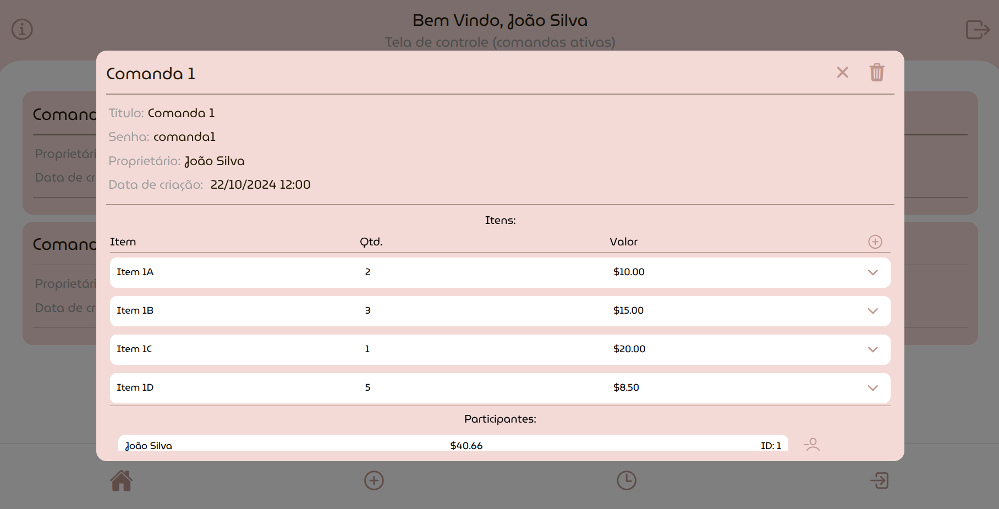
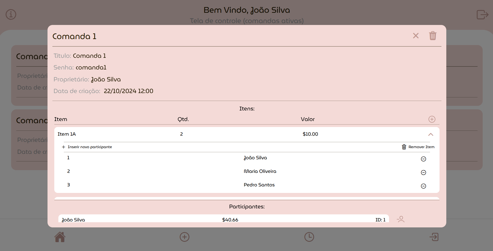
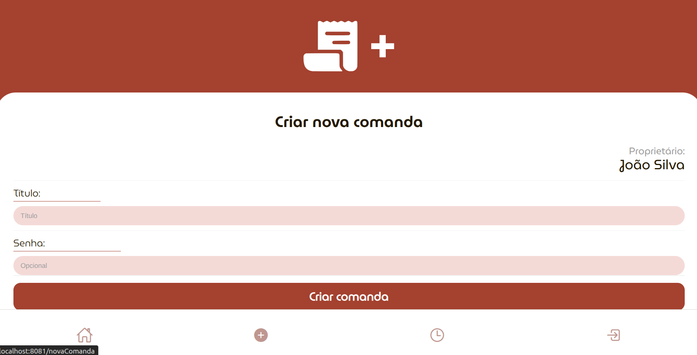
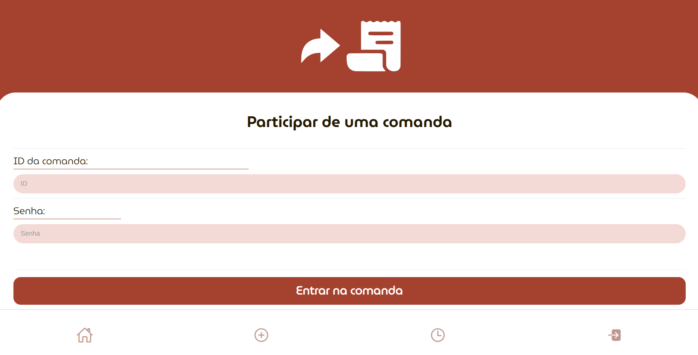

# Divide Aí — Shared Tabs & Bill Splitting

**Divide Aí** is an application for managing shared tabs at restaurants, bars, and group gatherings. It allows users to track expenses, associate items with participants, and calculate how much each person owes.

Developed as an academic project in 2024.

## Features

- User registration and login.
- Create tabs, optionally protected by a password.
- Join existing tabs using their ID and password.
- Add and manage items, quantities, and prices.
- Assign participants to individual items.
- Split item costs among participants and track individual totals.

## Technologies

- **Frontend:** React Native, Expo SDK 51, Expo Router, TypeScript, NativeBase.
- **Backend:** Node.js and Express.
- **Database:** PostgreSQL, using `pg-promise`.
- **Platforms:** React Native application with Expo Web support.

## Screenshots

### Login



### Active Tabs



### Tab Details and Items



### Item Participants



### Create a Tab



### Join a Tab



## Running Locally

**Requirements:** Node.js and npm (Node.js 20 is recommended for compatibility with this older Expo project), and PostgreSQL with the `psql` command-line tool.

**1. Clone the repository and install dependencies:**

```bash
git clone https://github.com/joaohenalves/Projeto-PGP-2024.2.git
cd Projeto-PGP-2024.2
npm install --legacy-peer-deps
```

**2. Set up the database:**

On Ubuntu, start PostgreSQL and run the included SQL scripts:

```bash
sudo systemctl start postgresql
sudo -u postgres psql -d postgres -f server/db/database.sql
sudo -u postgres psql -d divide_ai_db -f server/db/pop.sql
```

The second SQL script is optional and inserts sample data. **Note:** `database.sql` recreates the project's tables; do not run it against a database containing data you want to keep.

Check the PostgreSQL connection settings in `config.js` (database name, user, password, host, and port) and adjust them to your local environment.

**3. Start the backend:**

```bash
npm run start-backend
```

**4. In a separate terminal, start the web application:**

```bash
npm run web
```

Open the local URL displayed by Expo in your browser (typically `http://localhost:8081`).

If you loaded the sample data, you can sign in with the demo account: `joao.silva@example.com` / `senha123`.

> The project uses an older Expo version and was developed for academic purposes. Some dependency or environment adjustments may be needed on newer systems.
